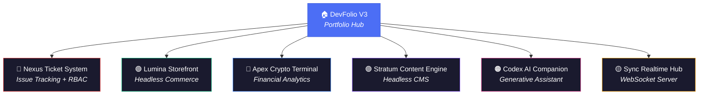

<div align="center">

# Ethan Greer | Full-Stack Ecosystem

**7 high-performance applications demonstrating modern architecture, real-time systems, and AI integration.**

[](https://nextjs.org)
[](https://typescriptlang.org)
[](https://tailwindcss.com)
[](https://prisma.io)
[](https://vercel.com)

</div>

---

## Architecture

This portfolio hub serves as the central gateway to a microservices-inspired ecosystem — 6 standalone applications, each deployed independently and built to production standards.



## The Applications

| Service | Stack | Key Patterns |
|---------|-------|-------------|
| **[Nexus Ticket System](https://github.com/EthanGreer/Nexus-Ticket-System)** | Prisma · NextAuth · SQLite | RBAC, Ticket State Machines, Relational DB Design |
| **[Lumina Storefront](https://github.com/EthanGreer/Lumina-Storefront)** | Zustand · Prisma · Stripe | Client State Management, Checkout Flows, Cart Persistence |
| **[Apex Crypto Terminal](https://github.com/EthanGreer/Apex-Crypto-Dash)** | Recharts · SWR · CoinGecko | Real-time Data Viz, API Caching, Graceful Degradation |
| **[Stratum Content Engine](https://github.com/EthanGreer/Stratum-Content-Engine)** | TipTap · Zod · Middleware | Rich Text Editing, Input Validation, Route Protection |
| **[Codex AI Companion](https://github.com/EthanGreer/Codex-AI-Companion)** | Vercel AI SDK · OpenAI | Streaming UI, Token Rendering, Mock/Live Modes |
| **[Sync Realtime Hub](https://github.com/EthanGreer/Sync-Realtime-Chat)** | Socket.io · Express | WebSocket Architecture, Presence Tracking, Multi-room |

## Tech Stack

```
Frontend        Next.js 15 (App Router) · React 19 · TypeScript 5.7
Styling         Tailwind CSS 3.4 · Custom Design System · Glassmorphism
State           Zustand · SWR · React Context
Database        Prisma 6 · SQLite
Auth            NextAuth v5 · Cookie-based Middleware
Real-time       Socket.io · Custom Express Server
AI              Vercel AI SDK · OpenAI (with mock fallback)
Charts          Recharts
Deployment      Vercel · GitHub Actions
```

## Quick Start

```bash
git clone https://github.com/EthanGreer/DevFolio-V3.git
cd DevFolio-V3
npm install
npm run dev
```

Open [http://localhost:3000](http://localhost:3000) to view the hub.

## Design Philosophy

- **Dark-mode Glassmorphism** — backdrop-blur effects with translucent borders
- **Shared Design Tokens** — brand (blue-indigo) and surface (neutral-gray) color scales
- **Typography** — Inter for UI, JetBrains Mono for code
- **Micro-animations** — fade-in, slide-up, and hover transitions throughout

---

<div align="center">
  <sub>Built with precision by <b>Ethan Greer</b></sub>
</div>
